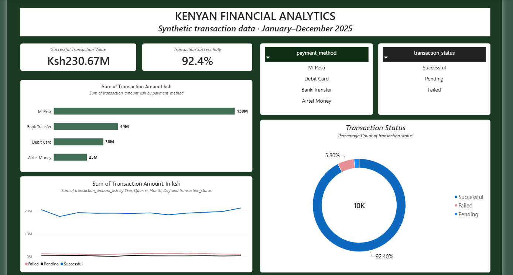
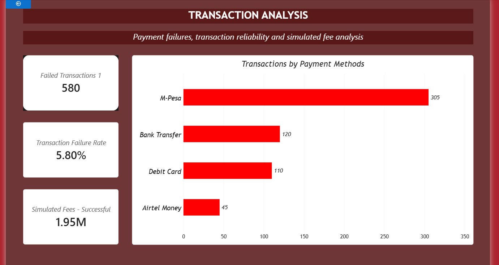
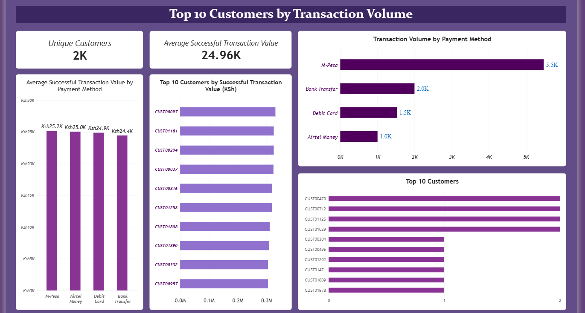

# Kenyan Financial Analytics Dashboard

## Overview

An end-to-end financial analytics portfolio project using Python, SQL, SQLite, and Power BI to analyse transaction performance, payment methods, transaction failures, customer activity, and monthly trends.

The project demonstrates data generation, validation, database management, SQL analysis, data preparation, and interactive business intelligence reporting.

## Project Highlights

- Built an end-to-end financial analytics workflow using Python, SQL, SQLite, and Power BI.
- Generated and validated a dataset of 10,000 synthetic Kenyan-style financial transactions.
- Analysed transaction success, failure rates, payment methods, customer activity, and monthly trends.
- Developed a three-page interactive Power BI dashboard for financial performance monitoring.
- Created reusable SQL reports and data-validation scripts to support reproducible analysis.
- Documented data quality checks, assumptions, and limitations to support responsible interpretation.

**Portfolio focus:** Financial analytics | Data cleaning and validation | SQL reporting | Business intelligence | Power BI

## Project Objectives

- Analyse transaction volumes and transaction values.
- Measure transaction success and failure rates.
- Compare payment methods by transaction volume and performance.
- Explore monthly transaction trends.
- Analyse customer activity and successful transaction values.
- Build an interactive Power BI dashboard.
- Communicate business insights and recommendations.

## Technology Stack

- **Python** - dataset generation, validation, and preparation.
- **SQLite** - structured storage of transaction records.
- **SQL** - transaction, payment method, monthly trend, and customer activity analysis.
- **Power BI** - interactive dashboard and visual analytics.
- **CSV and Markdown** - data exchange and project documentation.
- **Git** - version control.

## Dataset

The project uses 10,000 synthetic Kenyan-style financial transactions covering 2025.

The dataset contains transaction identifiers, dates, customer identifiers, customer segments, payment methods, transaction types, transaction amounts in Kenyan shillings, transaction statuses, and simulated fees.

**Important:** The data is synthetic. It does not represent actual Kenyan customers, financial institutions, or real financial activity. Fees are simulated and must not be interpreted as actual business revenue.

## Key Dataset Metrics

- Total transactions: 10,000
- Successful transactions: 9,240
- Failed transactions: 580
- Pending transactions: 180
- Transaction success rate: 92.4%
- Transaction failure rate: 5.8%
- Unique customers: 1,987
- Successful transaction value: KSh 230,673,724.53

These figures describe the synthetic dataset and are provided for demonstration purposes.

## Dashboard Preview

The dashboard contains three interactive pages designed to explore transaction performance, payment methods, and customer activity.

### Executive Dashboard

### Transaction Analysis

### Customer Analysis

*Note: The screenshots show illustrative analysis based on synthetic transaction data. The interactive dashboard is available in the `powerbi/` folder.*

## Dashboard Pages

### 1. Executive Dashboard
Summarises transaction performance, successful transaction value, success rate, payment methods, monthly trends, and transaction status.

### 2. Transaction Analysis
Examines failed transactions, failure rates, payment method performance, and simulated fees associated with successful transactions.

### 3. Customer Analysis
Explores unique customer counts, average successful transaction value, transaction activity, customer transaction values, and payment method usage.

## Project Structure

- `generate_dataset.py` - generates the synthetic transaction dataset.
- `validate_dataset.py` - validates the raw dataset.
- `load_database.py` - loads records into SQLite.
- `verify_database.py` - verifies database contents.
- `prepare_powerbi_data.py` - prepares data for Power BI.
- `validate_processed_data.py` - validates the processed dataset.
- `sql/analysis/` - reusable SQL analysis scripts.
- `reports/sql_exports/` - exported analytical reports.
- `documentation/data_dictionary.md` - data dictionary.
- `powerbi/` - Power BI dashboard file.
- `screenshots/` - project screenshots.
- `README.md` - project overview and documentation.

## Data Quality and Limitations

- Transaction data is synthetic and intended for learning and portfolio demonstration.
- Customer segments are assigned at the transaction level and should not be treated as permanent customer classifications.
- Simulated fees are not actual revenue.
- Dashboard results can change when slicers or filters are applied.
- The findings should not be used to make real financial decisions.

## Project Status

- Synthetic dataset generation and validation completed.
- SQLite database creation and verification completed.
- SQL analysis and CSV report exports completed.
- Power BI data preparation completed.
- Three-page interactive Power BI dashboard developed.
- Portfolio documentation and presentation improvements in progress.

## Responsible Use

This project is educational. All transaction data is synthetic, and all findings are illustrative rather than claims about real financial institutions or customers.
